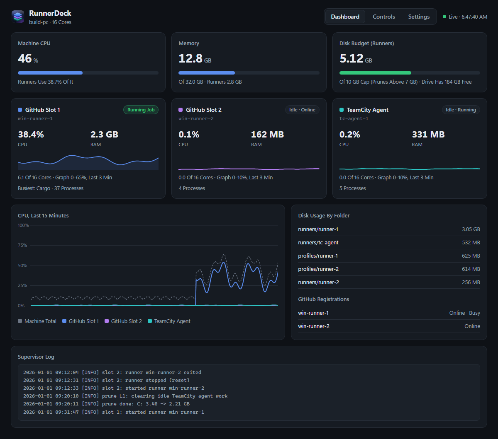
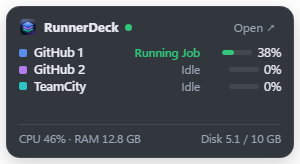

# RunnerDeck

A small desktop app for watching and controlling self-hosted CI runners (GitHub Actions and TeamCity) on
the machine they run on. It lives in the system tray (or the macOS menu bar) and has a desktop widget.
Built with [Tauri 2](https://v2.tauri.app) (Rust + a plain HTML/JS front end, no framework).



- **Tray icon:** the RunnerDeck stack, one layer per runner (GitHub 1, GitHub 2, TeamCity, top to bottom).
  While a runner works, its layer stays lit, the idle layers dim, and the badge pulses blue with a play mark.
  Otherwise the badge shows the state: green idle, amber needs a look (paused, stopped or above the prune
  target), red if the status service is down or the disk is over the cap. Hover for a summary; click to open.
- **Dashboard:** machine CPU and RAM, each runner's state, CPU, RAM and busiest process, 15 minutes of CPU
  history, the runner disk budget, GitHub registrations and the supervisor log. Refreshes every 2 s.
- **Desktop widget:** a small live card, optionally kept on top. Choose where it appears on start (top left,
  top right, bottom left, bottom right) or let it remember where you last dragged it.
  
- **Controls:** pause all GitHub runners, start or stop each GitHub slot, start or stop the TeamCity agent,
  and free up disk space (quick clean, deep clean, deep clean including shared caches). A running job or
  build always finishes first.
- **Settings:** start at sign-in, the widget, and the runner settings (disk hard cap, prune target, room
  needed per job, log retention, check interval, keep the runner up to date).

RunnerDeck runs as the signed-in user, without admin rights. It never controls runners directly: it reads a
local status feed and asks the runner supervisor (a privileged service you provide) to act by writing small
request files. It needs no elevation and opens no network port.

## How it fits together

```
RunnerDeck (user)  ── GET /api/status ──▶  status service (privileged, 127.0.0.1 only, read-only)
        │
        └── writes config/runners.json and state/* request files ──▶  runner supervisor (privileged)
```

RunnerDeck does not install runners. It works with any runner tooling that provides the two things below.

## Runner tooling contract

**1. A status feed:** `GET http://127.0.0.1:<port>/api/status` (default port 8765) returning JSON:

```jsonc
{
  "host": "build-pc", "sampleSeconds": 2, "historyMinutes": 15, "paused": false,
  "machine": { "cpu": 12, "ramUsedGB": 9.4, "ramTotalGB": 32, "cores": 16 },
  "cap": { "usedGB": 2.2, "capGB": 10, "softGB": 7, "driveFreeGB": 120,
           "items": [{ "name": "runners/runner-1", "gb": 0.24 }] },
  "runners": [
    // id: gh1, gh2, … for GitHub slots, tc for TeamCity. state starts with
    // "Running…" (busy), "Idle…" (fine) or anything else (needs a look).
    { "id": "gh1", "label": "GitHub slot 1", "name": "win-runner-1", "state": "Idle · online",
      "cpu": 0.0, "ramMB": 160, "processes": 4, "busiest": "-" }
  ],
  "github": { "error": null, "runners": [{ "name": "win-runner-1", "status": "online", "busy": false }] },
  "log": ["2026-01-01 12:00:00 [INFO] slot 1: started runner win-runner-1"],
  "history": { "machine": [12, 9], "gh1": [0, 0] },
  "controls": { "paused": false, "stoppedSlots": [], "teamcityStopped": false, "prunePending": false }
}
```

`cpu` is a share of the whole machine (all cores), so 6.25 % on 16 cores is one full core.

**2. A tooling folder** (set in Settings) that the supervisor watches:

| Path | Meaning |
|---|---|
| `config/runners.json` | `budget.hardCapGB`, `softGB`, `minFreeToStartGB`, `logRetentionDays`, `watchdogSeconds`, `runner.autoUpdatePackage`, `slots` |
| `state/PAUSE` | exists: take all GitHub runners offline after their current job |
| `state/STOP-slot-<n>` | exists: take GitHub slot *n* offline after its current job |
| `state/STOP-teamcity` | exists: stop the TeamCity agent after its current build |
| `state/prune-request.json` | `{ "level": 1 or 2, "targetGB": 0, "allDrives": bool }`; the supervisor deletes it and writes `state/prune-result.json` |

RunnerDeck only edits the fields listed for `runners.json` and keeps everything else in the file as it is.

## Build

You need **Node.js 20+** (with npm) and **Rust stable** (via [rustup](https://rustup.rs)), plus the platform
pieces below. The full Tauri prerequisites list is at <https://v2.tauri.app/start/prerequisites/>.

### Windows (10 or 11, x64)

1. Install **Microsoft C++ Build Tools** (Visual Studio Installer, workload *Desktop development with C++*,
   which includes MSVC and the Windows SDK).
2. **WebView2 runtime:** built into Windows 11; on Windows 10 install the Evergreen runtime from Microsoft.
3. Install Rust with the MSVC toolchain and Node.js:
   ```powershell
   winget install Rustlang.Rustup OpenJS.NodeJS.LTS
   rustup default stable-x86_64-pc-windows-msvc
   ```
4. Build:
   ```powershell
   git clone <this repo> runnerdeck
   cd runnerdeck
   npm install
   npm run build:win
   ```
   The app is `src-tauri\target\release\runnerdeck.exe`, a single file with no installer. Copy it somewhere
   permanent, for example `%LOCALAPPDATA%\Programs\RunnerDeck\RunnerDeck.exe`, and run it.

To keep your local folder names out of the binary (Rust embeds source paths), build releases with:
```powershell
$env:RUSTFLAGS = "--remap-path-prefix=$PWD=/src --remap-path-prefix=$env:USERPROFILE=/home"
npm run build:win
```

### macOS (11 Big Sur or later, Apple silicon or Intel)

1. Install the Xcode command-line tools: `xcode-select --install`
2. Install Rust and Node.js:
   ```bash
   curl --proto '=https' --tlsv1.2 -sSf https://sh.rustup.rs | sh
   brew install node            # or the installer from nodejs.org
   ```
3. Build:
   ```bash
   git clone <this repo> runnerdeck
   cd runnerdeck
   npm install
   npm run build:mac
   ```
   The app and disk image are under `src-tauri/target/release/bundle/macos/RunnerDeck.app` and
   `src-tauri/target/release/bundle/dmg/`. Drag RunnerDeck.app into Applications.
4. For a universal (Intel + Apple silicon) build:
   ```bash
   rustup target add x86_64-apple-darwin aarch64-apple-darwin
   npx tauri build --target universal-apple-darwin --bundles app,dmg
   ```

The build is not signed or notarised. On first launch macOS will block it: right-click RunnerDeck.app,
choose **Open**, then confirm (or allow it under *System Settings › Privacy & Security*). To sign and
notarise, see <https://v2.tauri.app/distribute/sign/macos/>.

On macOS, RunnerDeck appears in the menu bar with a short status word next to the icon, and
**Start at login** is a LaunchAgent.

### Develop

```bash
npm run dev        # runs the app with the front end reloading on change
```

The front end is plain files in `src/` (`index.html` + `app.js` for the main window, `widget.html` +
`widget.js` for the widget). The Rust side is `src-tauri/src/main.rs` (tray, polling, commands) and
`src-tauri/src/icon.rs` (tray icon composition).

### Artwork

The artwork is drawn in code with PowerShell 7 on Windows (System.Drawing):

- `scripts/draw-icon.ps1` makes `app-icon.png`; `npm run icons` regenerates every app icon size from it.
- `scripts/draw-tray.ps1` makes the tray sprites in `src-tauri/icons/tray/`, which `icon.rs` composes at
  runtime.

The generated files are committed, so building on macOS doesn't need them re-drawn.

## First run

1. Start RunnerDeck. It opens the main window; closing the window keeps it in the tray.
2. In **Settings**, set the **runner tooling folder** and check the **status service** address, then Save.
3. Optionally turn on **Start with Windows / Start at login** and the **desktop widget**.

App settings are stored in `%APPDATA%\com.runnerdeck.desktop\settings.json` on Windows and
`~/Library/Application Support/com.runnerdeck.desktop/settings.json` on macOS.

## Licence

No licence has been chosen yet; all rights reserved by the authors.
